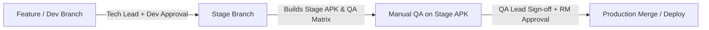

# Target Architecture — AuctionNow AI-Assisted SDLC

```text
PR event -> GitHub Actions (Deterministic CI Baseline)
 └── Stage 1: Engineering Quality & Security Reviewer (Scanner Reports + LLM Advisory)
      └── HITL Gate: Shahbaz / Saif (Tech Lead)
           └── Stage 2: SDET Test Planner (Categorized Test Proposals + Clarification Requests)
                └── HITL Gate: Shaheb / Tooba (Senior Dev)
                     └── CI Execution: Unit, Integration & API Tests on Candidate Commit
                          └── Stage 3: QA Director (Risk-Based Manual Matrix + Coverage Proof)
                               └── HITL Gate: Siaira / Tabbasum (QA Lead)
                                    └── Stage 4: Release & CI Evidence Gate
                                         └── HITL Gate: Hassan / Shahbaz (Release Manager)
                                              └── Existing GitHub Protected Branch Merge Controls
```

---

## 1. Guiding Architectural Principles

1. **Vendor-Neutral & In-House Orchestration:**
   CodeRabbit is NOT an assumed default. AuctionNow builds and owns the internal orchestration, evidence contracts, and policy layer. Any commercial LLM or external tool must satisfy a strict security, data-privacy (Zero Data Retention), and licensing evaluation first.
2. **Deterministic Precedence:**
   Objective scanner findings (Gitleaks, Semgrep, OSV, Linters) are strictly differentiated from contextual AI suggestions. A finding is only marked `confirmed_by_deterministic_tool: true` when a verified tool independently produced it.
3. **Lazy Stage Execution:**
   Downstream agents are never executed if an upstream stage is rejected by its human reviewer. This prevents dirty context propagation and avoids unnecessary resource consumption.
4. **Zero Autonomous Authority:**
   Agents provide bounded, structured, auditable evidence only. They cannot merge PRs, push commits, deploy code, or modify branch protection rules.
5. **Role-Based Human-in-the-Loop (HITL) Governance:**
   Each stage is reviewed by a distinct stakeholder persona. Agents cannot approve their own output. Every approval is cryptographically bound to the candidate commit SHA and the artifact's SHA-256 digest.

---

## 2. Stage Contracts & Schemas

### Stage 1: Engineering Quality & Security Reviewer
- **Assigned Persona:** `tech_lead` (Shahbaz / Saif)
- **Inputs:** PR diff metadata, changed files, and normalized deterministic scanner reports (`fixtures/sample_scanner_reports.json`).
- **Normalized Ingestion:**
  - **Gitleaks:** Detects hardcoded credentials and sensitive tokens; automatically redacts secrets in findings.
  - **Semgrep:** Detects security bugs, authorization gaps (IDOR), and injection risks with line numbers.
  - **OSV-Scanner:** Detects known dependency vulnerabilities (CVEs/GHSAs).
  - **Linters (Ruff/ESLint):** Detects code style, unused imports, and maintainability concerns.
- **Contract:** Outputs `Stage1ReviewArtifact` containing categorized `Finding` objects (`id`, `category`, `severity`, `confidence`, `evidence`, `file_path`, `line_number`, `explanation`, `recommendation`, `confirmed_by_deterministic_tool`, `source_tool`).
- **Policy Gate:** Automatically sets `policy_blocked: true` if unresolved Critical or High severity findings exist.

### Stage 2: SDET Test Planner
- **Assigned Persona:** `developer` (Shaheb / Tooba)
- **Inputs:** PR metadata, changed surfaces, acceptance criteria (`fixtures/sample_requirements.json`), and Stage 1 review findings.
- **Contract:** Outputs `Stage2TestPlanArtifact` with structured `TestCaseProposal` objects categorized across:
  - `positive`: Core happy-path business scenarios.
  - `negative`: Stale quote rejection, invalid state transitions.
  - `boundary`: Precise expiration timestamp limits.
  - `authorization`: Cross-buyer / IDOR tenant boundary denial.
  - `failure`: Database timeout recovery and transaction rollback.
  - `platform`: Mobile UI debounce and duplicate submission prevention (`AcceptQuoteButton.tsx`).
- **Clarification Protocol:** Formulates structured `ClarificationRequest` objects for ambiguous or missing business rules instead of guessing.
- **Safety Boundary:** All proposals carry `status: "proposed_not_executed"`. No code is written or committed.

### Stage 3: QA Director (Risk-Based Manual Test Matrix)
- **Assigned Persona:** `qa_lead` (Siaira / Tabbasum)
- **Inputs:** Acceptance criteria, changed components, Stage 2 test plan, Stage 1 findings, and automated test execution results (`fixtures/sample_ci_evidence.json`).
- **Contract:** Outputs `Stage3QAPlanArtifact` with a prioritized `ManualTestMatrixRow` table.
- **Automation Evidence Rule:** Prohibits marking scenarios covered without verified passing test reports matching the candidate commit. Unexecuted proposals are explicitly marked `"None — proposal only; no verified CI execution report"`.
- **Ownership:** Explicitly assigns ownership across `qa_engineer_backend`, `qa_engineer_mobile`, and `qa_lead`.

### Stage 4: Release & CI Evidence Summarizer
- **Assigned Persona:** `release_manager` (Hassan / Shahbaz)
- **Inputs:** Machine-readable CI test runs, security findings, QA sign-offs, and the full chain of HITL approval records.
- **Decision Engine:**
  - `PASS`: Emitted ONLY when CI tests pass, QA sign-off is verified, zero high/critical blockers exist, all 3 upstream role approvals exist, and all evidence strictly matches `candidate_commit_sha`.
  - `BLOCKED`: Emitted if any check failed, evidence is stale or commit-mismatched, or any stage was rejected.
  - `NEEDS_HUMAN_REVIEW`: Emitted if deterministic checks pass but non-critical advisory warnings exist.
- **Merge/Deploy Authority:** Strictly remains with GitHub branch protection and designated human release managers.

---

## 3. Cryptographic Audit & Tamper Protection

Every approval record emitted by the orchestrator conforms to the following schema:
```json
{
  "stage": "agent_1_review",
  "decision": "approve",
  "role": "tech_lead",
  "approver_name": "Shahbaz / Saif (Tech Lead)",
  "timestamp_utc": "2026-10-21T06:32:25.850754+00:00",
  "commit_sha": "mockcommit-104-a1b2c3",
  "artifact_sha256": "7b68f38e6e3f2a92393359fd16a5436f215c51d0fe0187bd22cf9289384528fa",
  "reason": "Verified and approved by Shahbaz / Saif (Tech Lead) for candidate commit mockcommit-104-a1b2c3"
}
```

If a new commit is pushed to the PR branch:
1. The candidate commit SHA changes.
2. Prior approvals and test run artifacts tied to the old SHA become invalid.
3. The pipeline resets and requires re-evaluation from Stage 1.

---

## 4. Declarative Branch Promotion & Governance Policies

Branch promotion policies are externalized in `policies/branch_governance.json` and enforced by `sdlc_lab/branch_policy.py`:



| Environment / Target Branch | Authorized Roles | Required Gates | Automated Artifacts Triggered |
| :--- | :--- | :--- | :--- |
| **`dev`** (`dev`, `feature/*`) | **Tech Lead** (Shahbaz / Saif)<br>**Senior Dev** (Shaheb / Tooba) | 0 Critical/High scanner flaws<br>CI unit/integration tests | Scanner & Review JSON |
| **`stage`** (`stage`, `release/*`) | **Tech Lead**<br>**Senior Dev**<br>**QA Lead** (Siaira / Tabbasum) | Clean dev baseline<br>SDET test proposals reviewed<br>QA manual plan approval | **Triggers Stage APK build** for internal QA manual validation |
| **`prod`** (`main`, `prod`) | **Tech Lead**<br>**Senior Dev**<br>**QA Lead**<br>**Release Manager** (Hassan / Shahbaz) | 100% CI pass rate<br>Zero High/Critical flaws<br>Verified QA on Stage APK<br>Release Manager deployment auth | Release Audit Trail (`artifacts/latest_run.json`) |

---

## 5. Scanner Ingestion & CI Orchestration

### Subprocess Scanner Runner (`sdlc_lab/local_runner.py`)
Executes real deterministic scanners as subprocesses with safety controls:
- **Zero Repo Mutation:** Scanners run strictly in read-only mode against source code.
- **Enforced Timeouts:** 120s timeout per tool preventing runner hangs.
- **No False Passing:** Missing binaries emit an explicit `SKIPPED` warning with remediation instructions rather than silently passing.
- **Supported Engines:**
  - `gitleaks detect --no-git --report-format json`
  - `semgrep scan --config auto --json`
  - `osv-scanner --format json`
  - `ruff check --output-format json`
  - `npx eslint . --format json`

### CI Orchestrator (`sdlc_lab/ci_orchestrator.py` & GitHub Actions)
Orchestrates the entire governance pipeline within `.github/workflows/sdlc_pipeline.yml`:
1. Ingests scanner JSON reports from `artifacts/scanners/`
2. Ingests automated test results from `artifacts/tests/`
3. Evaluates target branch promotion policies
4. Generates rich GitHub Step Summaries (`$GITHUB_STEP_SUMMARY`)
5. Emits comprehensive, tamper-evident audit report (`artifacts/latest_run.json`)
