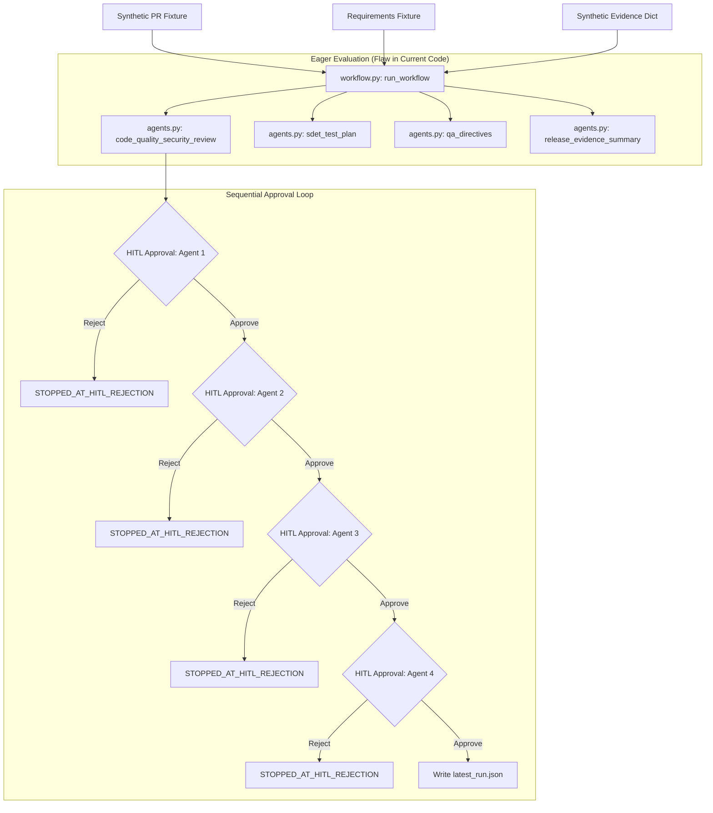
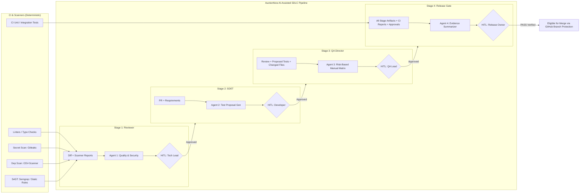

# Current Design Review & Architecture Assessment
**AuctionNow AI-Assisted SDLC Lab**
**Author:** Solution Architect & Senior Engineering Advisor
**Date:** 2026-10-21
**Status:** Baseline Discovery & Architecture Proposal (Pre-Implementation)

---

## 1. Executive Summary

AuctionNow is prototyping an AI-assisted Software Development Life Cycle (SDLC) workflow with Human-in-the-Loop (HITL) governance across four stages:
1. **Agent 1:** Engineering Quality & Security Reviewer
2. **Agent 2:** SDET Test Planner
3. **Agent 3:** QA Director (Risk-Based Manual Test Matrix)
4. **Agent 4:** Release & CI Evidence Summarizer

This review establishes the baseline discovery of the starter repository, executes baseline tests and demos, identifies architectural and security gaps, assesses deterministic scanning candidates under commercial/licensing constraints, establishes confirmed facts vs. assumptions, and presents a prioritized implementation plan with acceptance criteria.

---

## 2. Baseline Discovery & Execution Record

### 2.1 Repository Inventory & Inspection
| File / Directory | Size / Lines | Purpose & Current State |
| :--- | :--- | :--- |
| `README.md` | 26 lines / 2,081 B | Project overview, run instructions, vendor-neutral stance, safety boundaries. |
| `docs/architecture.md` | 37 lines / 3,209 B | Target architecture diagram, agent contracts, evidence model, rollout plan. |
| `docs/roadmap.md` | 19 lines / 1,288 B | 7-step roadmap from discovery to release summary and acceptance criteria. |
| `fixtures/sample_pr.json` | 8 lines / 404 B | Synthetic PR data (`SYNTHETIC-PR-104`, commit `mockcommit-104-a1b2c3`, diff excerpt with `TODO: add authorization`). |
| `fixtures/sample_requirements.json` | 10 lines / 338 B | 4 acceptance criteria for quote acceptance feature. |
| `sdlc_lab/__init__.py` | 0 lines | Package marker. |
| `sdlc_lab/__main__.py` | 5 lines / 74 B | CLI entrypoint running `run_demo()`. |
| `sdlc_lab/agents.py` | 94 lines / 5,215 B | Mock implementations of 4 agents; naive substring checks; mock data objects. |
| `sdlc_lab/workflow.py` | 59 lines / 2,779 B | Orchestrator executing the 4 stages, calculating SHA-256 digests, and collecting HITL terminal prompts. |
| `tests/test_agents.py` | 37 lines / 1,690 B | 5 unittest cases covering mock pattern matching, proposal flags, evidence blocker, and rejection halt. |
| `artifacts/latest_run.json` | Generated | Execution artifact generated by `sdlc_lab`. |
| `.gitignore` | 9 lines | Ignores Python caches, virtual environments, and artifacts. |

### 2.2 Environment & Execution Commands

A clean virtual environment was initialized using Python 3.11:
```powershell
py -3.11 -m venv .venv
```
**Verification:**
```powershell
.venv\Scripts\python.exe --version
# Output: Python 3.11.0
```

#### Test Suite Execution
```powershell
.venv\Scripts\python.exe -m unittest discover -s tests -v
```
**Result:**
```text
test_missing_release_evidence_blocks (test_agents.AgentTests.test_missing_release_evidence_blocks) ... ok
test_mock_reviewer_flags_auth_todo (test_agents.AgentTests.test_mock_reviewer_flags_auth_todo) ... ok
test_qa_does_not_claim_coverage (test_agents.AgentTests.test_qa_does_not_claim_coverage) ... ok
test_rejection_stops_workflow (test_agents.AgentTests.test_rejection_stops_workflow) ... ok
test_tests_are_proposals_not_execution (test_agents.AgentTests.test_tests_are_proposals_not_execution) ... ok

----------------------------------------------------------------------
Ran 5 tests in 0.001s
OK
```

#### Demo Run Execution (All Stages Approved)
```powershell
"y`ny`ny`ny" | .venv\Scripts\python.exe -m sdlc_lab
```
**Result:**
- Stages visited: `agent_1_review`, `agent_2_test_plan`, `agent_3_qa_plan`, `agent_4_release_summary`
- Final status: `BLOCKED` (expected because synthetic CI evidence has `ci_passed=False`, `qa_signed_off=False`, etc.)
- Report artifact: written to `artifacts/latest_run.json` (SHA-256 digests computed for each stage)

#### Demo Run Execution (Stage 1 Rejection)
```powershell
"n" | .venv\Scripts\python.exe -m sdlc_lab
```
**Result:**
- Stages visited: `agent_1_review` (rejected)
- Final status: `STOPPED_AT_HITL_REJECTION`
- Downstream stages skipped in report output.

---

## 3. Current Code & Data Flow Analysis



### Flow Breakdown & Observations:
1. **Inputs:** `sample_pr.json` and `sample_requirements.json` are read from disk.
2. **Eager Precomputation Bug:** In `workflow.py` (lines 29–33), `review`, `plan`, `qa`, and `release_evidence_summary` are executed *prior* to entering the approval loop. Even if Stage 1 is rejected, Stages 2, 3, and 4 have already executed in memory. In an agentic environment calling an LLM or running scans, this leaks unapproved intermediate inputs downstream and wastes resources.
3. **Artifact Digests:** `workflow.py` computes SHA-256 digests of artifacts using `hashlib.sha256(json.dumps(..., sort_keys=True))`.
4. **HITL Prompt:** Terminal prompt collects `y/N`, generates an approval record with a generic label `local_demo_operator`, and appends it to `report["approvals"]`.
5. **Final Status:** Set to `STOPPED_AT_HITL_REJECTION` on rejection, or the status of Agent 4 (`BLOCKED` or `NEEDS_HUMAN_REVIEW`).

---

## 4. Gaps and Limitations

### 4.1 Orchestration & Workflow Gaps
- **Eager Execution:** Agents are invoked upfront instead of conditionally after prior stage HITL sign-off.
- **Untyped Generic Payloads:** Stages pass unstructured dicts; there is no runtime schema enforcement.
- **Missing Role-Specific Approvers:** HITL approvals record `local_demo_operator` for all stages rather than role-bound identities (Tech Lead, Developer, QA Lead, Release Manager).
- **No Invalidation on Commit Changes:** If a commit SHA changes, prior approvals and evidence are not invalidated automatically.

### 4.2 Agent 1 (Code Quality & Security Reviewer) Gaps
- **Literal Pattern Mock Only:** Checks `eval(` and `todo: add authorization` via string containment.
- **No Deterministic Tool Ingestion:** No interface or data contract to ingest reports from linters, static analyzers, secret scanners, or dependency scanners.
- **Incomplete Finding Contract:** `Finding` dataclass lacks `file_path`, `line_number`, `explanation`, and does not separate deterministic tool findings from LLM advisory observations.
- **No Vendor-Neutral Abstraction:** Direct hardcoded functions rather than a pluggable scanner/evaluator contract.

### 4.3 Agent 2 (SDET Test Planner) Gaps
- **Superficial Proposal Generation:** Simply wraps acceptance criteria strings with template text (`"Verify criterion: " + criterion`).
- **No Test Classification:** Fails to systematically produce positive, negative, boundary, authorization, failure, regression, and platform-specific cases.
- **No Clarification Protocol:** If acceptance criteria are ambiguous, contradictory, or missing, it does not formulate structured clarifying questions.
- **No Traceability Matrix:** Loose requirement IDs (`AC-001`, `AC-002`) without mapping back to changed components (`backend` vs. `mobile`).

### 4.4 Agent 3 (QA Director) Gaps
- **Direct Mirror of SDET:** Verbatim copies SDET titles into manual steps without operational test design (preconditions, test data setups, environment prerequisites).
- **Lacks Diff Context:** Ignores changed surfaces (e.g., `mobile/src/features/quotes/AcceptQuoteButton.tsx` implies mobile UI state, debounce, double-tap prevention).
- **Unverified Automation Claims:** Mentions `None - proposal only`, but has no parser to verify real CI test reports against matrix rows.

### 4.5 Agent 4 (Release & CI Evidence Summarizer) Gaps
- **Boolean-Only Flags:** Relies on hardcoded boolean flags (`ci_passed: True/False`) rather than parsing machine-readable evidence artifacts.
- **No Path to PASS:** Currently can only return `BLOCKED` or `NEEDS_HUMAN_REVIEW`; cannot validate all evidence to issue a justified `PASS`.
- **Commit Binding Gaps:** Only checks `evidence.get("commit_sha") == evidence.get("evidence_commit_sha")`, without verifying that individual test, scan, and approval artifacts match the candidate commit SHA.
- **Stale/Missing Report Blindness:** Does not verify timestamps, artifact digests, or completeness against a required release gate policy.

---

## 5. Risk Assessment

| Risk Area | Severity | Description | Mitigation Strategy |
| :--- | :--- | :--- | :--- |
| **Security: Hallucinated Vulnerabilities** | High | LLM flags false security alarms or misses real exploits. | Separate deterministic scanner findings from LLM insights. Require `confirmed_by_deterministic_tool: true` only when a tool verified it. |
| **Security: Data Leakage** | Critical | Sending proprietary code or secrets to external AI APIs. | Enforce mock/local execution by default. Redact diffs, strip credentials, and mandate explicit company approval before external LLM integration. |
| **Compliance: Autonomous Actions** | High | Agents attempting PR merge, branch writes, or permission updates. | Strict read-only boundary; GitHub Actions remains the deterministic orchestrator. Agents only emit recommendations. |
| **Integrity: Contaminated Evidence** | High | Using test/scan evidence from a previous commit SHA. | Cryptographically bind all evidence and approvals to `commit_sha` and artifact SHA-256 digest. Invalidate downstream approvals on new commits. |
| **Governance: Self-Approval** | Medium | Agent output accepted without human verification or self-approved. | Enforce distinct human approver roles; prevent agent identities from satisfying HITL gates. |
| **Licensing: Scanner Misuse** | High | Adopting scanners with viral copyleft, restrictive commercial clauses, or hidden cloud telemetry. | Conduct licensing review (OSV-Scanner, Gitleaks, Semgrep, Trivy, SonarQube) before inclusion. |

---

## 6. Assumptions vs. Confirmed Facts

### Confirmed Facts
1. **Repository Scope:** This repository is an isolated, mock-only prototype lab (`auctionnow_sdlc_starter`), not AuctionNow's production repository.
2. **Runtime Environment:** Python 3.11+ in a local virtual environment (`.venv`).
3. **No External Dependencies:** The starter runs standard library Python without third-party packages installed.
4. **Current Findings are Mocks:** The pattern checks in `agents.py` are literal mock checks and must not be portrayed as real scanners.
5. **Orchestrator Role:** GitHub Actions is the deterministic orchestrator. The prototype prototype does not execute branch pushes, PR merges, or deployments.

### Assumptions (Requiring Validation / Stated Explicitly)
1. **Target Stack:** Fixtures indicate a Python backend (`backend/app/quotes/service.py`) and a TypeScript/React Native mobile client (`mobile/src/features/quotes/AcceptQuoteButton.tsx`).
2. **Scanner Availability:** Assumes deterministic scanner outputs (SARIF, JSON) will be provided via CI pipelines or mock fixtures.
3. **LLM Provider:** Assumes any future LLM connectivity will require explicit enterprise agreement, data zero-retention guarantee, and opt-in flag.
4. **Approval Personas:** Assumes four distinct approver personas: Tech Lead (Stage 1), Developer (Stage 2), QA Lead (Stage 3), and Release Manager (Stage 4).

---

## 7. Deterministic Scanner Evaluation (Vendor-Neutral)

AuctionNow must not adopt proprietary tools blindly or rely on CodeRabbit as an assumed default. Below is an architectural evaluation of scanner candidates for AuctionNow's stack (Python + TypeScript):

| Tool | Category | License (Commercial Use) | Hosting / Privacy | Output Format | Fit for AuctionNow |
| :--- | :--- | :--- | :--- | :--- | :--- |
| **Gitleaks** | Secret Scanning | MIT | Local CLI / CI runner. 100% offline, zero network telemetry. | JSON, SARIF | **Strong Candidate:** Ideal for pre-commit and PR secret detection. Free, permissive, fast. |
| **OSV-Scanner** (Google) | Dependency Vulnerability | Apache-2.0 | Queries Google OSV database. CLI runs locally; hashes/deps sent to public OSV API. | JSON, SARIF | **Strong Candidate:** Open-source, no paid license required for commercial CI, supports Python (pip/poetry) and JS (npm/yarn). |
| **Semgrep OSS** | SAST & Quality | LGPL-2.1 (CLI engine) / Semgrep Registry terms | CLI engine is open source; rules from Semgrep Registry have specific terms. Semgrep Pro is proprietary. | JSON, SARIF | **Viable Candidate (with caution):** Verify rule license and registry terms for private commercial repos. Self-hosted runner compatible. |
| **Ruff / Flake8** | Python Linting & Quality | MIT | Local CLI, offline. Extremely fast. | JSON, text, SARIF | **Strong Candidate:** Standard, permissive Python linter and formatter. |
| **ESLint / TypeScript** | JS/TS Lint & Type Check | MIT / Apache-2.0 | Local CLI, offline. Standard for TypeScript. | JSON, SARIF | **Strong Candidate:** Essential for frontend/mobile code quality. |
| **Trivy** (Aqua) | Container & Dependency | Apache-2.0 | Local CLI, downloads open DB locally. | JSON, SARIF | **Alternative Candidate:** Broader scope (container, fs, deps, config). |
| **SonarQube / SonarCloud** | SAST & Quality Gate | LGPL-3.0 (Community) / Commercial (Enterprise/Cloud) | Self-hosted Community edition has limitations on branch/PR analysis in free tier. Cloud requires license for private repos. | Webhook, JSON API | **Requires Commercial Decision:** Free tier does not easily support multi-branch/PR decoration on private repos. |
| **CodeQL** (GitHub) | Deep SAST | GitHub Terms of Service | Free for public repos; requires GitHub Advanced Security (GHAS) license for private repos. | SARIF | **Requires Commercial Decision:** Outstanding if AuctionNow already licenses GitHub Enterprise + GHAS; not free for private commercial code. |

---

## 8. Target Architecture & Evidence Contract Design



### Core Design Principles:
1. **Lazy Execution / Pipeline Halting:** Stage $N$ is only invoked after Stage $N-1$ is approved. Rejection terminates execution immediately.
2. **Schema-Validated Contracts:** Every agent input and output is validated against a deterministic JSON schema (using Python standard library or clean dataclass validation).
3. **Traceable Evidence Integrity:** Every artifact includes:
   - `repository_id`
   - `pr_id`
   - `commit_sha`
   - `timestamp_utc`
   - `artifact_sha256`
   - `approver_identity` (role, name, decision, reason)
4. **Deterministic Separation:** Deterministic scanner findings carry `confirmed_by_deterministic_tool: true` with named tool metadata. Advisory LLM remarks carry `confirmed_by_deterministic_tool: false`.

---

## 9. Key Decisions Needed from Stakeholders

| Stakeholder | Key Decision Required | Architect Recommendation |
| :--- | :--- | :--- |
| **Product Manager (PM)** | Format and source of truth for acceptance criteria (e.g., Jira markdown, Gherkin syntax, JSON fields). | Use structured JSON/Gherkin acceptance criteria with unique IDs (`AC-01`, etc.) in PR descriptions. |
| **Tech Lead** | Policy thresholds for blocking PRs in Stage 1 (e.g., any High severity secret/SAST finding blocks; Medium warnings advisory). | High/Critical deterministic scanner findings are automatic blockers. Advisory LLM notes require human ack. |
| **QA Lead** | Criteria for mapping automated test results to manual test matrix rows (e.g., test naming conventions, test IDs). | Require automated test suites to emit JUnit XML or JSON test reports referencing requirement tags. |
| **Release Manager** | Mandatory sign-off quorum for Stage 4 (e.g., must have 4 distinct approvals from 4 separate roles). | Enforce role-based separation of duty: Tech Lead $\neq$ Developer $\neq$ QA Lead $\neq$ Release Owner. |
| **Security / Compliance** | Approved external LLM provider, data retention terms, and allowed model endpoints (or pure local/mock). | Default to mock/offline rule engine. For live pilot, use enterprise API with Zero Data Retention (ZDR). |

---

## 10. Prioritized Implementation Plan

### Phase 1: Core Framework, Schema Contracts & Orchestrator Refactor (Immediate)
- **Goal:** Replace eager execution with lazy, step-by-step orchestrator; implement strict schema validation; enhance HITL audit model.
- **Tasks:**
  1. Define unified dataclass / schema validation module (`sdlc_lab/schemas.py`) for:
     - PR & Requirements input
     - Scanner reports input (Gitleaks, Semgrep, OSV, Linters)
     - Stage 1, 2, 3, 4 artifact contracts
     - HITL approval audit record (with role, commit SHA, artifact SHA, timestamp)
  2. Refactor `sdlc_lab/workflow.py` to lazy execution: each stage runs only when its predecessor is approved.
  3. Ensure a rejection stops downstream execution cleanly without running future agents.
  4. Write comprehensive tests in `tests/test_workflow.py` validating pipeline halt, digest mismatch detection, and schema compliance.
- **Acceptance Criteria:**
  - Running workflow with rejection at Stage 1 never calls Agents 2, 3, or 4.
  - Every stage artifact passes schema validation.
  - All approvals are bound to `commit_sha` and `artifact_sha256`.

### Phase 2: Agent 1 — Vendor-Neutral Reviewer & Deterministic Ingestion
- **Goal:** Ingest multi-tool scanner reports (secret scanning, SAST, dependency scanning, linting) alongside advisory reviews.
- **Tasks:**
  1. Create scanner ingestion interfaces in `sdlc_lab/scanners.py` capable of normalizing real or fixture tool outputs (e.g., Gitleaks, OSV, Semgrep).
  2. Implement standard `Finding` schema: `id`, `category`, `severity`, `confidence`, `evidence`, `file_path`, `line_number`, `explanation`, `recommendation`, `confirmed_by_deterministic_tool`.
  3. Update `code_quality_security_review` to cleanly distinguish deterministic findings from advisory findings.
  4. Add synthetic fixtures for deterministic tool reports (`fixtures/sample_scanner_reports.json`).
  5. Add unit tests for valid findings, unconfirmed advisory notes, and malformed scanner reports.
- **Acceptance Criteria:**
  - No finding claims to be confirmed unless a deterministic tool produced it.
  - File/line are populated when provided by scanner/diff.
  - Handles empty and malformed scanner outputs gracefully.

### Phase 3: Agent 2 — SDET Test Proposal Generator
- **Goal:** Generate comprehensive test proposals categorized across positive, negative, boundary, authorization, failure, and platform dimensions.
- **Tasks:**
  1. Refactor `sdet_test_plan` to inspect changed files (backend vs. mobile) and requirements.
  2. Categorize proposed tests into: `positive`, `negative`, `boundary`, `authorization`, `failure`, `regression`, `platform`.
  3. Add detection for ambiguous or missing requirements: formulate explicit `clarification_questions`.
  4. Require test proposals to include preconditions, steps, expected results, priority, and rationale.
  5. Add unit tests for comprehensive coverage proposals and requirement clarification cases.
- **Acceptance Criteria:**
  - Emits categorized test cases with clear traceability to requirement IDs.
  - Identifies mobile vs backend surfaces from PR diff/changed files.
  - Identifies missing business rules and raises clarification requests instead of inventing rules.

### Phase 4: Agent 3 — QA Director (Risk-Based Manual Matrix)
- **Goal:** Synthesize diff metadata, review findings, and actual automated test results into an actionable risk-based QA matrix.
- **Tasks:**
  1. Refactor `qa_directives` to consume PR metadata, Stage 1 findings, Stage 2 test plan, and automated test execution results.
  2. Cross-reference automated test results: mark `automation_evidence` as `"None - proposal only"` unless passing automated test evidence covers the exact scenario.
  3. Include exploratory edge cases based on changed surfaces (e.g., network retry, debounce, UI race conditions for `AcceptQuoteButton.tsx`).
  4. Assign explicit QA role ownership and priority levels.
  5. Add unit tests verifying that unexecuted tests never count as automated coverage.
- **Acceptance Criteria:**
  - Generated rows distinguish passing automation from unverified proposals.
  - Surface-specific edge cases are included (mobile duplicate submission, backend authorization).
  - Explicit owner and actionable QA steps for every row.

### Phase 5: Agent 4 — Release & CI Evidence Summarizer & Gate Engine
- **Goal:** Validate all required CI, test, security, QA, and HITL approval evidence; return `PASS`, `BLOCKED`, or `NEEDS_HUMAN_REVIEW`.
- **Tasks:**
  1. Refactor `release_evidence_summary` to evaluate full machine-readable evidence:
     - CI unit/integration test results
     - Deterministic security scan reports
     - Unresolved High/Critical findings
     - QA test matrix sign-offs
     - Validated chain of HITL approvals with matching commit SHAs and artifact digests
  2. Implement strict policy checks:
     - If any required evidence is missing, stale, or commit SHA mismatched $\to$ `BLOCKED`.
     - If unresolved High/Critical security findings exist $\to$ `BLOCKED`.
     - If all checks pass and all approvals exist for the candidate commit $\to$ `PASS`.
     - If non-critical advisory warnings exist requiring human discretion $\to$ `NEEDS_HUMAN_REVIEW`.
  3. Add unit tests for all release gate outcomes (`PASS`, `BLOCKED`, `NEEDS_HUMAN_REVIEW`) and edge cases (stale commit, missing report, digest mismatch).
- **Acceptance Criteria:**
  - Emits `PASS` only when every condition is verifiably met on the candidate commit.
  - Emits `BLOCKED` with explicit human-readable reasons when any check fails.
  - Never initiates or suggests autonomous merge or deploy.

### Phase 6: Documentation, Fixtures & End-to-End Demo
- **Goal:** Provide reproducible CLI demo, updated documentation, and end-to-end integration tests.
- **Tasks:**
  1. Update `fixtures/` with realistic sample diffs, requirements, scanner outputs, and test reports.
  2. Update `README.md` and `docs/architecture.md` with complete usage instructions and contract specs.
  3. Provide an interactive and non-interactive demo mode in `sdlc_lab/__main__.py`.
  4. Ensure 100% test pass rate across the full test suite.
- **Acceptance Criteria:**
  - Demo runs cleanly from terminal and produces verified artifacts in `artifacts/`.
  - Full test suite passes via `.venv\Scripts\python.exe -m unittest discover -s tests -v`.
